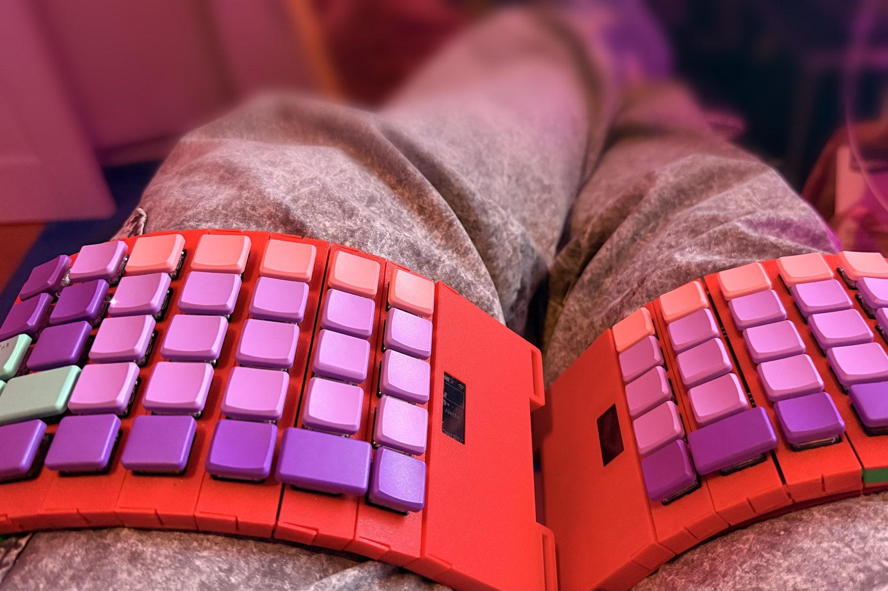

# roamyboard, aka Pants Keyboard

A keyboard you wear on your legs, so you can type while you walk. Each half is a row of 3D-printed modules on a strap: key modules that click together at an angle, so the half curves around a thigh, an MCU module with a nice!nano, a battery and a display, and a terminator module at the far end. It runs ZMK over Bluetooth, and the right half's display has a built-in PDA.

**Photos, the build and more: [roamyboard.nevyn.dev](https://roamyboard.nevyn.dev).** There you'll find the [assembly guide](https://roamyboard.nevyn.dev/assembly/), the [layout](https://roamyboard.nevyn.dev/layout/), the [PDA manual](https://roamyboard.nevyn.dev/pda/), and a page to [order one](https://roamyboard.nevyn.dev/order/).

But why‽ Because I think so much better when I'm moving. So I want to code while I move. So I need an input method that works while I'm moving. The original idea was to literally sew it into pants, but that's too impractical; now it's a strap you put on top of your pants.

I will also need a wearable [computer](roamykit/Computer.md) and [head mounted display](roamykit/Head%20mounted%20display.md) to go with this setup, but that's for later.

Made by [Nevyn Bengtsson](mailto:hello@nevyn.dev) 2012-2026 (this is not the first iteration 😅).

## What's in here

This repo is also an Obsidian vault, which is why it has wiki syntax here and there.

- `case/`: the case. `case/roamy-v4` is the current model, in Cadova (Swift): `swift run` there writes the printable 3MF files. Notes in [Case design](case/Case%20design.md) and [Harness design](case/Harness%20design.md). `roamy-v3.py` is the old CadQuery model.
- `electronics/`: the KiCad project for the key module board, and [Electronics](electronics/Electronics.md) with the bus and the joint.
- `zmk/`: the firmware, ZMK plus a driver for the key modules' shift register chain. [Firmware](docs/firmware.md) covers building, flashing over USB, updating over Bluetooth with `roamy-ota` or a phone, and [Logging](docs/logging.md) reading both halves' logs over Bluetooth with `roamy-log`; [Layout](zmk/Layout.md) covers the keymap.
- `docs/`: the website at roamyboard.nevyn.dev and the reference docs; [docs/index.md](docs/index.md) lists them.
- [Build Diary](Build%20Diary.md): what happened when.
- `firmware/`: the stock Lily58 firmware images from before the roamyboard had its own.

## Inspiration

The construction started from [ScottoChoczard](https://scottokeebs.com/blogs/keyboards/scottochoczard-handwired-keyboard), a hand-wired, PCB-less split that doesn't have to be flat, and the layout from the [Lily58](https://typeractive.xyz/pages/build/lily58), which is wireless on a nice!nano with a conventional four-row layout. Since then it got its own PCBs and modules. More in [Inspiration](Inspiration.md).
