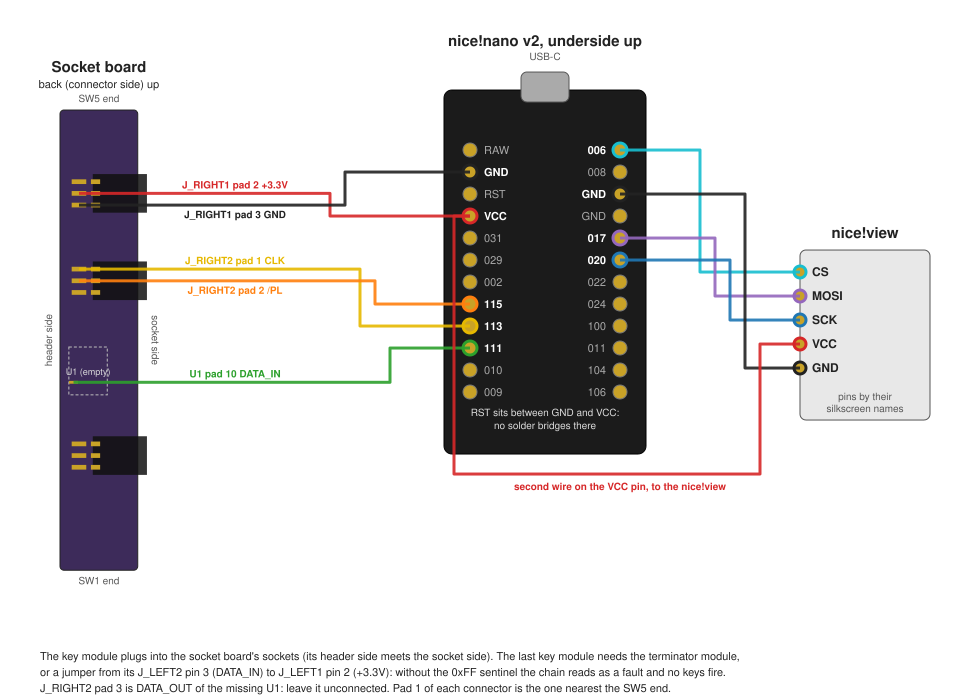

# Firmware

roamyboard runs [ZMK](https://zmk.dev) on the nice!nano v2 in the MCU module. `zmk/` holds an out-of-tree ZMK module (a kscan driver, its devicetree binding and the shields) and the user config (`zmk/config`: west manifest, keymaps, settings). ZMK is pinned in `zmk/config/west.yml`; move the pin deliberately, since board names, bindings and Kconfig symbols change on ZMK's main branch.

| Path | What |
| --- | --- |
| `zmk/drivers/kscan/chain.c`, `chain.h` | Pure logic: sentinel search, key module count stabilizing, column mapping, key event bookkeeping. No Zephyr dependencies. |
| `zmk/drivers/kscan/kscan_165_chain.c` | Zephyr glue: SPI, /PL, polling, debouncing, the kscan callback. |
| `zmk/dts/bindings/kscan/roamyboard,kscan-165-chain.yaml` | The driver's devicetree binding; every property is documented there. |
| `zmk/dts/roamyboard.dtsi` | Devicetree shared by all shields: pins, the chain node, the 24 × 5 physical layout and matrix transform. |
| `zmk/boards/shields/roamyboard/` | The unibody shield. |
| `zmk/boards/shields/roamyboard_split/` | The `roamyboard_left` and `roamyboard_right` shields. |
| `zmk/config/roamyboard.keymap`, `roamyboard_split.keymap` | Keymaps (below). |
| `zmk/include/roamyboard/` | Public headers: the build ID, the key module count getter, the `roamyboard_chain_state_changed` event, the host names and their settings format, the status screen's bootloader view, rebooting into the bootloader, the PDA mode and its `roamyboard_pda_changed` event. |
| `zmk/cmake/build_id.cmake`, `zmk/src/build_id.c` | The build ID (Building, below). |
| `zmk/src/ble/host_names.c` | Reads each Bluetooth host's name and keeps it per profile (below). |
| `zmk/src/display/` | The status screen on the nice!view (below). `screen.c` draws with LVGL only; `status_screen.c` feeds it ZMK's state. `cat.c` is the cat's pure logic; `cat_frames.c` and its headers are generated. |
| `zmk/src/behaviors/behavior_boot_screen.c`, `zmk/dts/behaviors/boot_screen.dtsi` | `&boot_screen` and `&ota_boot`, the bootloader keys; their binding is in `zmk/dts/bindings/behaviors/`. |
| `zmk/src/pda/`, `zmk/src/behaviors/behavior_pda.c`, `zmk/dts/behaviors/pda.dtsi` | The micro PDA: PDA mode and the split data channel on each half, the note editor, and the PDA and Note keys ([Micro PDA](pda.md)). |
| `zmk/src/midi/`, `zmk/src/behaviors/behavior_midi_note.c`, `zmk/dts/behaviors/midi.dtsi` | The BLE-MIDI service on the central and the MIDI note key ([MIDI](midi.md)). |
| `zmk/src/bootloader.c` | Shows the bootloader view and reboots into the bootloader's UF2 or OTA mode, for the bootloader keys and the local OTA key. |
| `zmk/src/local_ota.c` | The split peripheral's local OTA key (Updating over Bluetooth, below). |
| `zmk/tests/` | Host tests for the pure logic: `zmk/tests/run.sh`. |
| `zmk/tools/` | `cat_frames.py` generates the cat's bitmaps; `screen_mock/run.sh` renders the status screen on the host; `ota/` builds `roamy-ota`, which updates halves over Bluetooth (Updating over Bluetooth, below); `midi/` builds `roamy-midi`, which checks the keyboard's MIDI from a Mac ([MIDI](midi.md)). |

## Reading the chain

Each key module has one 74HC165. Its inputs A to E are SW1 (the bottom key, at the SW1 end) to SW5 (the top key); F, G and H are tied to GND. The 165s of a half form the **chain**: each 165's QH feeds the SER input of the next 165 toward the MCU module, and the MCU module reads QH of the nearest key module on DATA.

Every scan:

1. The driver pulses /PL low for 1 µs. All 165s load their switch states, and QH shows input H of the nearest key module.
2. The driver reads `max-key-modules + 1` bytes (33 by default) over SPIM2 at 1 MHz, MSB first. Each byte is one key module, nearest first:

   | Bit | 7 | 6 | 5 | 4 | 3 | 2 | 1 | 0 |
   | --- | --- | --- | --- | --- | --- | --- | --- | --- |
   | Input | H | G | F | E | D | C | B | A |
   | Key | always 0 | SW7 | SW6 | SW5 | SW4 | SW3 | SW2 | SW1 |
   | Row | | 0 (7-key) | 1 (7-key) | 0 | 1 | 2 | 3 | 4 |

3. The first byte with bit 7 set is the **sentinel**: the terminator module ties the far end's DATA to +3.3V, so the bytes after the last key module read 0xFF. The sentinel's index is the key module count. No key modules means the first byte is the sentinel. DATA has the nRF52840's pull-up, so an MCU module with nothing attached also reads as zero key modules.

Row 0 is the top key. The `rows` property (default 5) sets how many inputs each key module uses, so a 7-key module needs only `rows = <7>`.

The SPI bus runs in mode 2 (`spi-cpol`): SCK idles high, SPIM2 samples DATA on each falling edge, and the 165s shift on each rising edge, so every sample lands half a clock period after the last shift. The first falling edge samples input H of the nearest key module, which is on QH straight after /PL. Mode 0 would sample on the same rising edge that shifts, and then depend on the 165's propagation delay, which the datasheet gives no minimum for.

## Key module count

Key modules are hot-pluggable, so the driver counts them on every scan, never only at boot. A new count is accepted only after `stable-scans` (default 3) consecutive scans observe it. While the observed count differs from the accepted one, the driver reports no key events; a key module that is sliding on or off makes the count bounce, and the keys of a half-connected chain read garbage.

When a new count is accepted, the driver first releases every key that it reports pressed and resets its debouncers, and then maps the key modules to keymap columns again. Keys that are still held get pressed again after debouncing, at their new keymap columns.

A scan whose bytes contain no sentinel is a **fault**: a missing terminator module, a broken DATA or /PL line, or more key modules than `max-key-modules`. The driver logs it at most every 5 s with the raw bytes and the number of faulty scans since the last report. A fault is fed to the stabilizer like a count: when it persists for `stable-scans` scans, the driver releases all keys, so that a broken chain cannot leave keys stuck on the host. Leaving an accepted fault takes `recovery-scans` (default 100, about 1 s at the idle pace) scans of one count. Without its terminator module, the farthest key module's SER input floats and can read like a terminator for a while, for example while a hand is near it; the long run keeps such a chain silent, so the status screen's "no term" and the keys agree.

The driver scans every `poll-period-ms` (10 ms) while idle, and every `debounce-scan-period-ms` (1 ms) while a key is pressed or debouncing. A settling count keeps the idle pace, so `stable-scans` spans about 30 ms. Debouncing uses ZMK's integrator debouncer per key: 1 ms to press, 10 ms to release (`zmk/dts/roamyboard.dtsi`).

## Columns and anchors

The **physical column** is a key module's position in the chain: 0 is the key module nearest the MCU module. On the left half and a unibody, the MCU module sits at the right end and the terminator module at the left end, so physical columns count right to left. The right half of a split is the same hardware turned by 180 degrees in the plane of its keys (a **rotated half**): its MCU module sits at its left end, next to the left half, so its physical columns count left to right.

The **keymap column** is where a key module's keys land in the 24-column keymap. Each shield's chain node owns `columns` keymap columns and has an **anchor**, the end of the half that keymap columns are counted from:

| Anchor | Keymap column of physical column p | With fewer key modules than columns |
| --- | --- | --- |
| `mcu` | columns − 1 − p | the leftmost keymap columns never fire |
| `mcu`, `rotated` | p | the rightmost keymap columns never fire |
| `terminator` | count − 1 − p | the rightmost keymap columns never fire |

The chain node's `rotated` property mirrors the column order (column c becomes columns − 1 − c) and the row order: on a rotated half SW1 is the top key, so row r reads input r instead of input rows − 1 − r. It also turns `ROAMYBOARD_STATUS_SCREEN_ROTATE_180` off by default, since the turned half shows the nice!view the right way up. All three follow the one property, so they cannot disagree.

The `terminator` anchor is the only mapping that depends on the key module count: adding a key module anywhere moves every keymap column. No shipped build uses it. Key modules that map outside `0` to `columns − 1` are ignored: with the `mcu` anchor those are the ones nearest the terminator module, with the `terminator` anchor the ones nearest the MCU module.

A split roamyboard anchors both halves at their MCU modules, which sit at the middle of the keyboard:

```
              left half, anchor mcu                       right half, anchor mcu, rotated
 terminator  [8]  [9]  [10] [11]  MCU module  |  MCU module  [12] [13] [14] [15]  terminator
             p=3  p=2  p=1  p=0               |              p=0  p=1  p=2  p=3
```

Keymap columns are in brackets. With five key modules on each half, the left half fills keymap columns 7 to 11 and the right half 12 to 16, wherever in the half the fifth one goes.

The kscan reports keymap columns within its half; the matrix transform's `col-offset` of 12 on the right half places them in 12 to 23.

Every build uses one physical layout, 24 × 5 keys (positions `row * 24 + column`), so ZMK Studio shows the full width and the keys of missing key modules never fire. The width keeps every position below 128: ZMK's Bluetooth split sends the peripheral's held keys as a 16-byte bitmap (`POS_STATE_LEN` in `app/src/split/bluetooth/service.c`), so the central never hears a position of 128 or more. A wider layout would put the right half's bottom row at 128 or above, where its keys never reach the central. A half therefore uses at most 12 key modules.

## Builds

`zmk/build.yaml` lists three builds, all for the nice!nano v2 (`nice_nano//zmk`, default revision 2.0.0) with the nice!view (`nice_view_adapter nice_view`):

| Build | Shield | Role | Columns | Anchor | ZMK Studio |
| --- | --- | --- | --- | --- | --- |
| `roamyboard` | `roamyboard` | unibody | 0 to 23 | `mcu` | yes |
| `roamyboard_left` | `roamyboard_left` | split central | 0 to 11 | `mcu` | yes |
| `roamyboard_right` | `roamyboard_right` | split peripheral | 12 to 23 | `mcu`, rotated | no |

The split role is fixed at compile time. ZMK Studio runs over BLE and over USB (the `studio-rpc-usb-uart` snippet), with locking off; the peripheral cannot host it.

The unibody and the split shields live in separate shield directories because ZMK picks the keymap by the shield directory's name before the shield's own name: all three would otherwise share `roamyboard.keymap`.

Deep sleep (`CONFIG_ZMK_SLEEP`) stays off: the chain is polled, so no key press can wake the nRF52840 from System OFF.

The 165s run from the nice!nano's VCC pin, which P0.13 switches. `roamyboard.dtsi` holds P0.13 high with a GPIO hog and disables ZMK's ext-power node, so that neither a keymap behavior nor a setting saved by earlier firmware can switch the chain off.

Releasing every held key queues one event per key at once, so each shield raises `CONFIG_ZMK_KSCAN_EVENT_QUEUE_SIZE` from ZMK's 4 to 32.

## Keymap

`zmk/config/roamyboard_split.keymap` (both halves) and `zmk/config/roamyboard.keymap` (unibody) implement the five layers in [Layout](../zmk/Layout.md), 7 key modules per half; the split keymap adds the two MIDI layers ([MIDI](midi.md)). On the split, the left half uses keymap columns 5 to 11 and the right half 12 to 18. The unibody puts the same layout on one chain, in keymap columns 10 to 16 and 17 to 23, so its key module nearest the MCU module is the right half's outer column. Every other position is `&none`. The System layer (hold L2, the left pinky's row 4 key) has Bluetooth profiles, output selection, soft off (`CONFIG_ZMK_PM_SOFT_OFF`, woken only by the reset button), `&boot_screen`, `&ota_boot` and `&sys_reset`, and mouse keys (`&mkp`, `&mmv`, `&msc`, which need `CONFIG_ZMK_POINTING`).

`&boot_screen` shows the bootloader view on the status screen and then reboots into the UF2 bootloader, like ZMK's `&bootloader`. `&ota_boot` does the same for the bootloader's Bluetooth DFU mode (Updating over Bluetooth, below). Both run on the half whose key triggered them. On the Keypad layer, the right half's outer column, row 5 (Return on QWERTY) is `&ret_boot`, a hold-tap that the keymaps define: a tap sends Return, and holding it for 1.5 s (`tapping-term-ms`, flavor `tap-preferred`, so other keys cannot make it a hold) triggers `&boot_screen`. That column is the key module nearest the MCU module, so a unibody with a single key module reaches the bootloader by holding L1 (row 4) and then row 5.

## Status screen

The nice!view shows roamyboard's own status screen (`zmk/src/display`), which replaces the nice!view shield's status widget: `zmk/config/roamyboard.conf` sets `CONFIG_NICE_VIEW_WIDGET_STATUS=n`, and the build stops with an error if both are on. The screen keeps the stock widget's look and is read with the nice!view upright: 68 px wide, 160 px tall, drawn as three 68 × 68 canvases that the firmware rotates.

The roamyboard mounts the nice!view with its contacts toward the MCU module, which shows the stock orientation upside down, so the firmware turns every image 180° on its way to the panel (`CONFIG_ROAMYBOARD_STATUS_SCREEN_ROTATE_180`, on by default): a wrapper around LVGL's flush callback reverses each flushed area and moves it to the opposite side of the panel.

| Part | Unibody and split central | Split peripheral |
| --- | --- | --- |
| Top row | Battery, and the output: USB, Bluetooth connected, disconnected, or not paired | Battery, and whether the central is connected |
| Box below it | The key module count and the cat | The key module count |
| Middle | The five Bluetooth profiles in a row, and the active profile's host name | While the central is not connected, the local OTA key hint ("hold the 0 key 3 s for OTA"); otherwise empty |
| Bottom | The name of the highest active layer | Empty |

For the first 3 s after the keyboard starts, the box shows the firmware's build ID (Building, below) instead, on every half, and the cat appears with the count on the unibody and the split central. A dirty build ID wraps after the dash. Then the box shows this half's own accepted key module count: "7 cols", "1 col", "0 cols". It shows "no term" while the accepted state is a fault, which usually means that the terminator module is missing, and "..." before the driver has accepted any count. The kscan driver raises `roamyboard_chain_state_changed` whenever it accepts a new count or a fault, and `roamyboard_chain_key_module_count()` returns the current state (`zmk/include/roamyboard/`). The split central shows no count after startup, only the cat: the PDA's Info app shows both halves' counts ([Micro PDA](pda.md)).

The cat lives in the box on the unibody and the split central. The split peripheral has no cat; its box shows only the key module count, in the middle of the box.

The cat reacts to keycodes, not to key positions: it listens to `zmk_keycode_state_changed`, which the keymap raises after it has resolved layers, hold-taps and the like, so the same physical key does different things on different layers. `cat_classify_key()` (`cat.c`) sorts keyboard-page usages into typing keys and special keys; the host tests cover it.

| Key | What the cat does |
| --- | --- |
| Letters, digits, punctuation, Tab, the keypad's digits, operators and dot | Walks 2 px right and advances its walk cycle. Typing keys less than 150 ms apart make it run instead, 4 px per key with a run cycle, until the pace slows again. |
| Space | Walks, with a small hop mid-stride. |
| Enter, keypad Enter, Up | Jumps up and comes back down, in place. |
| Backspace, Delete | Moonwalks: walks 2 px left while it faces right, with the walk cycle played backwards. |
| Left, Right | Turns to face that way and walks that way. |
| Down | Flattens into a crouch for a moment. |
| Home, End | Scampers to the left or right end of the box. |
| Modifiers, F-keys, Esc, Caps Lock, Print Screen, media keys, layer keys | Nothing. |

The cat also takes a pose from the highest active layer. On Keypad it sits up with its ears perked. On System it drops into a hunting crouch: holding a mouse-move key makes it stalk that way, 2 px every 200 ms (up raises its head, down flattens it), and a mouse click makes it pounce. On Gaming it gets ready to pounce and wiggles its rump for a second, and every key press, typing key or not, is a leap forward; Left and Right turn it first. On Locked it scampers to the middle of the box and flops down as a loaf, and nothing moves it, like a cat sleeping on the keyboard. When the Locked layer goes away, it stretches and gets up. Arrows and typing keys work on every layer except Gaming and Locked; on Keypad and System the cat returns to its pose 400 ms after a stride. When the active Bluetooth profile changes, the cat dashes off the right edge and comes back in from the left to where it was; a profile change before the cat has appeared (at boot) does nothing.

Mouse keys raise no keycode event: `&mkp` and `&mmv` report straight to Zephyr's input subsystem, and ZMK no longer raises `zmk_mouse_button_state_changed`. So the cat also listens to `zmk_position_state_changed` and looks up the binding that a press triggers: the highest active layer's binding at that position that is not `&trans`, through `zmk_keymap_get_layer_binding_at_idx()`. It compares the binding's behavior device name with those of `&mkp` and `&mmv`, and decodes the direction of `&mmv` from its parameter with `MOVE_X_DECODE` and `MOVE_Y_DECODE`. It remembers which position started a stalk and ends the stalk when that position is released, even if the layer has changed in between.

The keymaps mark the layers that have a pose with the node labels `keypad_layer`, `system_layer`, `gaming_layer` and `locked_layer`. `status_screen.c` turns each label into a layer ID at compile time with `DT_NODE_CHILD_IDX`, since ZMK numbers layer IDs by the keymap node's children; the build fails if a label marks something other than a layer of the keymap. The ID stays the same when ZMK Studio reorders or renames layers. A keymap without one of the labels has no layer with that pose. `DT_NODE_CHILD_IDX` counts disabled children too, so the IDs match ZMK's only while every layer of the keymap has status "okay", as in both keymaps.

The cat's x runs from just off the left edge of the box interior to just off its right edge. Walking or running off one side crops it out, and it comes back in, cropped, from the other side, in both directions. When no key has been pressed for 2 s the cat sits down, with no layer pose, and it blinks every 4 s while sitting. After 30 s it curls up and sleeps, in every pose, with a z that comes and goes every second.

The cat is an LVGL image inside a container that covers the box interior (in the screen's rotated coordinates), so LVGL crops whatever lies outside the box, and a step redraws only the few rows that the cat covers instead of the whole canvas. The frames are stored already rotated, with a transparent background, so that the cat's ink lies over the count text when the two meet. Jumps rise at most 5 px, which keeps the cat clear of the count text. Each frame has a mirror image for facing left; the z of the sleeping frames stays unmirrored.

`cat.c` is pure logic without Zephyr: a small state machine that takes events with their times (keys, mouse keys, poses, profile changes) and answers which frame the cat shows at a given time, where, facing which way, and for how long that stays correct. Each action is a short script of timed frames with offsets, after an optional run. The listener in `status_screen.c` queues events with their time on the thread that raises them, and the display work queue feeds them to the cat and redraws when the view changes, at most once per 40 ms for key-driven motion, so a burst of key presses moves the cat several steps in one redraw. The memory LCD redraws only on change: the Gaming wiggle stops after a second, sleeping redraws once a second, and other poses hold still.

`zmk/tools/cat_frames.py` holds the cat's pixel art and generates `cat_frames.c`, `cat_frames.h` (the frame enum, with no LVGL, for the host tests) and `cat_frame_images.h` from it, and renders every frame to `/tmp/roamy-screen/frames.png`. `zmk/tools/screen_mock/run.sh` compiles `screen.c`, `cat.c` and LVGL from the west workspace on the host and renders the screen in several states to `/tmp/roamy-screen/`, so a layout change can be checked without hardware: `states.png` shows the panel's own image (line 1 at the top) and `states-on-leg.png` what a person sees on the mounted nice!view. `cat-actions-on-leg.png` shows every cat action as a row of the count box, one cell per change of the cat's view, labeled with the action and the time; `cat-actions.png` shows the same as the panel's own image.

### Host names

The middle part shows a row of five profile markers. The active profile is a filled disc with its number; of the others, a filled dot is connected, a ring is paired but not connected, and a small dot is unpaired. Whether the active profile is connected shows in the top row's output icon. Below the markers is the active profile's host name, even while the output is USB: in Montserrat 14 on up to three lines, in Montserrat 12 if it needs more, and cut with ".." if it still does not fit.

The name is the host's GAP Device Name (characteristic 0x2A00). After a host's link is encrypted (Zephyr's `security_changed` callback), and after every `zmk_ble_active_profile_changed` (which also follows a new pairing, whose profile address ZMK sets only after encryption), the firmware checks every paired profile and reads the name of each connected, encrypted host that it has not read during that connection yet. It reads by UUID over the whole handle range, without discovery, and reads the value again by handle as a long read if the first response may have cut it short. So a reconnection reads the name again, and switching profiles only shows the other profile's stored result. This needs Zephyr's GATT client, which the unibody and the split central enable (`CONFIG_ROAMYBOARD_HOST_NAMES`); the split peripheral has no hosts.

The screen shows each outcome of the read as it is, so that what each kind of host reports can be seen without a logging build: the name with trailing NULs and whitespace trimmed, "(empty)" for a zero-length name, "..." while the read is pending, "read err" and a negative errno if the read could not be sent, "att err" and the ATT error code if the host or the stack answered with one, "unpaired" for an unpaired profile, and "no name" for a paired profile whose name is not known.

Each profile's last name is stored in the settings key `roamyboard/host/<n>`, with `<n>` the profile index 0 to 4. The value is the name as UTF-8 bytes, 1 to 64 bytes, without a terminating NUL. The firmware loads the keys at boot, so a profile shows its last name while its host is away, and ignores a key with an index or length out of range, with a warning. It writes the key after each read that returns a non-empty name, cut at a character boundary to 64 bytes, and deletes it when the profile's pairing is cleared. An empty name is shown but not stored. `zmk/include/roamyboard/host_name.h` states the same contract for a tool that writes names.

### Bootloader view

`&boot_screen` asks the status screen for the bootloader view: "BOOT LOADER", a download icon and "drop a UF2 on NICENANO". `&ota_boot` asks for the OTA view: "OTA BOOT", a Bluetooth glyph and "send the DFU zip over Bluetooth". Both views show the build ID in small text at the bottom, so it stays on the display while the bootloader runs: the nice!nano keeps VCC on there, which powers the display. Both are the same driver, and the behavior node's `mode` property (`uf2` or `ota`) selects the view and the bootloader mode. The display work queue draws it on all three canvases, stops every other update, and calls `lv_refr_now()`. The nice!view's 1-bit flush callback writes to the display before it returns, so the view is on the display when `lv_refr_now()` returns, and the behavior reboots into the bootloader from there. If the view has not been written within 1 s, or the display is not initialized, the behavior logs a warning and reboots without it.

### Choosing the bootloader mode

The nice!nano's Adafruit nRF52 bootloader reads the nRF52840's GPREGRET register after a reset: 0x57 starts UF2 over USB and 0xA8 starts DFU over Bluetooth (OTA). The register keeps its value across a soft reset.

`&boot_screen` calls Zephyr's `bootmode_set(BOOT_MODE_TYPE_BOOTLOADER)`. On `nice_nano//zmk`, ZMK's `nrf52840_uf2_boot_mode.dtsi` makes the chosen `zephyr,boot-mode` partition a `zmk,bootmode-to-magic-mapper`, which turns the bootloader boot mode into `CONFIG_ZMK_BOOTMODE_BOOTLOADER_MAGIC_VALUE` (0x57) and writes it to the chosen `zmk,magic-boot-mode` partition. That partition is a one-byte `zephyr,retention` partition on the `nordic,nrf-gpregret` node at 0x4000051C, which is GPREGRET.

Zephyr's boot modes have no OTA mode, so `&ota_boot` writes 0xA8 with `retention_write()` straight to the `zmk,magic-boot-mode` partition. Both keys then call `sys_reboot(SYS_REBOOT_WARM)`. On this ZMK revision nothing writes GPREGRET after that: `sys_reboot()` locks interrupts and stops the RTC1 system timer, and the Cortex-M `sys_arch_reboot()` only sets SYSRESETREQ in the SCB. ZMK's `NRF_STORE_REBOOT_TYPE_GPREGRET` symbol, which once made `sys_reboot()` store its argument in GPREGRET, has had no effect since Zephyr 3.6 removed the code behind it.

## Pins

The firmware chooses the pins; the MCU board does not exist yet. Until it does, the MCU module takes the socket board, wired to the nice!nano as below. The interconnect pins are the socket board's J_LEFT sockets (pinout in [Electronics](../electronics/Electronics.md)); pin 1 is the topmost pin of each connector.

| Signal | nice!nano pin | nRF52840 | Socket board |
| --- | --- | --- | --- |
| +3.3V | VCC | switched by P0.13 | J_LEFT1 pin 2 |
| GND | GND | | J_LEFT1 pin 3 |
| CLK | D15 | P1.13, SPIM2 SCK | J_LEFT2 pin 1 |
| /PL | D18 | P1.15, GPIO | J_LEFT2 pin 2 |
| DATA | D14 | P1.11, SPIM2 MISO, pull-up | J_LEFT2 pin 3 |
| SDA | D4 | P0.22, TWIM1 SDA, 2.2 kΩ to VCC | J_LEFT3 pin 2 |
| SCL | D5 | P0.24, TWIM1 SCL, 2.2 kΩ to VCC | J_LEFT3 pin 3 |
| INT | D6 | P1.00, GPIO | J_LEFT1 pin 1 |

LED (J_LEFT3 pin 1) stays unconnected for now. SDA, SCL and INT serve the [pointing module](../electronics/Pointing%20module.md); two 2.2 kΩ pull-ups in the MCU module tie SDA and SCL to VCC, and the firmware also turns on the nRF52840's own pull-ups on both lines.

Solder the wires to the sockets' solder joints (J_LEFT), not to the empty header pads (J_RIGHT) or U1's pads: those reach the sockets through 0.25 mm tracks, and on the first socket board a wire tugging on a header pad broke the +3.3V and GND connections.



Power: battery + through the JST PH jack and the power switch to the nice!nano's B+ pad, battery − to B−. The reset button closes RST to GND; a double press enters the UF2 bootloader. Neither the JST nor the electrokit datasheet says which jack pin the battery's + lands on, and the Alps drawing was not read for the switch's common terminal: check both with a meter before connecting the battery. With the switch off, USB still powers the board but the battery does not charge (read from the nice!nano schematic, untested).

The nice!view, as ZMK's `nice_view_adapter` maps it on the nice!nano:

| nice!view | nice!nano pin | nRF52840 |
| --- | --- | --- |
| VCC | VCC | switched by P0.13 |
| GND | GND | |
| SCK | D3 | P0.20, SPIM0 SCK |
| MOSI | D2 | P0.17, SPIM0 MOSI |
| CS | D1 | P0.06, active high |

Why these pins:

- The chain runs on SPIM2 with SCK on D15 and MISO on D14, the pins of the nice!nano's `pro_micro_spi` (SPIM1); it has no MOSI. SPIM1 shares its peripheral with TWIM1, which the pointing module's I2C needs.
- SDA, SCL and INT are on D4, D5 and D6, next to the nice!view's wires on the same edge. The free pins on the chain's edge, D19 to D21 (P0.02, P0.29, P0.31), are "low frequency I/O only" in the nRF52840 product specification.
- spi0 belongs to the nice!view (SCK D3/P0.20, MOSI D2/P0.17, CS D1/P0.06) and shares its peripheral with i2c0.
- D18 sits next to D15 on the header row that also carries VCC and GND, so all five wires leave from one edge of the nice!nano. It is not an NFC pin (D10 and D16 are) and not a UART pin (D0 and D1).

## Building

GitHub Actions (`.github/workflows/build.yml`) builds all three UF2s and their DFU zips on every push that touches `zmk/`, and runs the host tests. ZMK's reusable `build-user-config` workflow cannot build this repo: it expects the config and `zephyr/module.yml` at the repo root, and it checks ZMK out into `./zmk`, which is this repo's module. The workflow does the same steps with the right paths. Download the UF2s and DFU zips from the run's artifacts.

Local build with Docker, from the repo root. The west workspace lives outside the repo and is reused between builds; keep it out of /tmp, which macOS empties:

```sh
ws=${WS:-$HOME/.cache/roamyboard-west}
mkdir -p "$ws/config" && cp zmk/config/west.yml "$ws/config/"
docker run --rm -v "$ws:/west" -v "$PWD:/repo:ro" -w /west zmkfirmware/zmk-build-arm:4.1 sh -c '
  [ -d .west ] || { west init -l config && west update --fetch-opt=--filter=tree:0; }
  west zephyr-export
  west build -p -s zmk/app -d build/roamyboard -b nice_nano//zmk -S studio-rpc-usb-uart -- \
    -DZMK_CONFIG=/repo/zmk/config -DZMK_EXTRA_MODULES=/repo/zmk \
    -DSHIELD="roamyboard nice_view_adapter nice_view" \
    -DCONFIG_ZMK_STUDIO=y -DCONFIG_ZMK_STUDIO_LOCKING=n'
ls -l "$ws/build/roamyboard/zephyr/zmk.uf2"
```

For the split halves use `-d build/roamyboard_left` with `SHIELD="roamyboard_left nice_view_adapter nice_view"` (same snippet and Studio flags), and `-d build/roamyboard_right` with `SHIELD="roamyboard_right nice_view_adapter nice_view"` without `-S studio-rpc-usb-uart` and the Studio flags. For USB logs, add the `zmk-usb-logging` snippet (`-S zmk-usb-logging`) and read the nice!nano's serial port.

The host tests need only a C compiler: `zmk/tests/run.sh`.

### Build ID

Every firmware carries a build ID: the git commit that it was built from, as 7 hex digits ("3274ed3"), with "-dirty" appended when tracked files under `zmk/` had uncommitted changes ("3274ed3-dirty"). Only `zmk/` (the module, the keymaps and the settings) goes into the firmware, and the build image has no git-lfs, so outside `zmk/` its git would see every Git LFS file as modified. Untracked files do not count. `zmk/cmake/build_id.cmake` runs `git rev-parse` and `git diff --quiet HEAD -- .` in the module's directory and writes the ID to a generated header, `roamyboard_build_id.h`. It runs at CMake configure time and again before every build, and rewrites the header only when the ID changed, so an incremental build cannot keep a stale ID. When git is missing or fails, the ID is "unknown", the build prints why ("roamyboard build ID: unknown (...)"), and the build goes on. `roamyboard_build_id()` (`zmk/include/roamyboard/build_id.h`) returns the ID, and the firmware logs "roamyboard <id>" once at boot.

The builds run git as another user than the one that owns the checkout, so `build_id.cmake` passes `-c safe.directory=*`. CI gets the real commit: `actions/checkout` leaves a `.git` directory with the commit in the workspace that the build container mounts; a pull request builds, and identifies, GitHub's merge commit. In a git worktree, `.git` is a file that points into the main checkout's `.git` directory, which the container cannot see, so the ID would be "unknown". Mount the main repository's git directory, and point `build_id.cmake` at the worktree's part of it with `ROAMYBOARD_GIT_DIR` and `ROAMYBOARD_GIT_WORK_TREE` (`GIT_DIR` itself would break west):

```sh
common=$(git rev-parse --path-format=absolute --git-common-dir)
gitdir=$(git rev-parse --path-format=absolute --git-dir)
docker run --rm -v "$ws:/west" -v "$PWD:/repo:ro" -v "$common:/gitcommon:ro" \
  -e ROAMYBOARD_GIT_DIR="/gitcommon/${gitdir#"$common"/}" -e ROAMYBOARD_GIT_WORK_TREE=/repo ...
```

## Flashing

1. Connect the nice!nano over USB and double-tap its reset button, or press Boot on the System layer, or hold L1 and hold the right half's outer row 5 key for 1.5 s. It mounts as a USB drive named NICENANO. The two keys first put the bootloader view on the status screen, and it stays there while the bootloader runs, since the nice!nano keeps VCC on there.
2. Copy the UF2 for that nice!nano onto the drive. The nice!nano flashes it and restarts.

For a split, flash `roamyboard_left` onto the left half and `roamyboard_right` onto the right. If the halves do not find each other after switching from other firmware, flash ZMK's `settings_reset` firmware onto both, then the roamyboard firmware again.

Once a half runs roamyboard firmware, later updates can go over Bluetooth instead (Updating over Bluetooth, below).

## Updating over Bluetooth

Once a half runs roamyboard firmware, later updates can go over Bluetooth instead of USB. The nice!nano's Adafruit nRF52 bootloader has an OTA mode, which takes a DFU zip over Bluetooth: from a Mac with `roamy-ota`, or from a phone with Nordic's nRF Device Firmware Update app (iOS and Android) or nRF Connect. Both work on the roamyboard: the iOS app updated the left half, and `roamy-ota` updated both halves of the split in one run. After each update, the status screen showed the new build ID at startup.

### From a Mac

You need:

- A Mac with macOS 14 or later, and the Swift 6 toolchain from Xcode or its command-line tools.
- [`gh`](https://cli.github.com), signed in to GitHub, to download the DFU zips of a CI run.
- A terminal app that may use Bluetooth. On the first run of `roamy-ota`, macOS asks whether the terminal app may use Bluetooth. A process that macOS cannot attribute to an app that may ask, such as an agent's shell, is killed instead.

Run each step from the repo root:

1. Download the DFU zips of a run of the Firmware workflow, for example the latest successful one on main. With several `-n`, `gh` puts each artifact in its own directory, and `roamy-ota` takes such a directory in place of the zip inside it. For a unibody, download `-n roamyboard` instead.

   ```sh
   gh run list --workflow Firmware --branch main --status success --limit 5
   gh run download RUN_ID -n roamyboard_left -n roamyboard_right -D fw
   ```

2. Build `roamy-ota` once, and again whenever `zmk/tools/ota` changes:

   ```sh
   swift build -c release --package-path zmk/tools/ota
   ```

   `--dry-run` shows what `roamy-ota` would send, and checks each zip, without Bluetooth:

   ```sh
   zmk/tools/ota/.build/release/roamy-ota --dry-run fw/roamyboard_left fw/roamyboard_right
   ```

3. Run `roamy-ota` with both zips, from a terminal app:

   ```sh
   zmk/tools/ota/.build/release/roamy-ota fw/roamyboard_left fw/roamyboard_right
   ```

4. Press OTA on each half when `roamy-ota` asks for it, and not before: the first half that appears in OTA mode gets the first zip. `roamy-ota` asks for the right half first ("Press OTA on the half for roamyboard_right.zip."), and then for the left half. OTA is on the System layer: hold L2 (the right thumb's fn⌫ key), and press OTA next to Boot on the right half, or under Boot on the left half. The status screen shows the OTA view while the half is in OTA mode.

   Both halves update at the same time, each with a progress line; updating both takes about three and a half minutes. `roamy-ota` exits with 0 once every half has validated and activated its new firmware, and each half then restarts with it.

5. When a half restarts, check the build ID that its status screen shows for the first 3 s: it is the commit of the new firmware, which `gh run view RUN_ID --json headSha` shows for the run.

### From a phone

1. Press OTA on the half.
2. In the nRF Device Firmware Update app, choose the DFU zip for that half, and turn Packet Receipt Notification on and set it to 8 or less. At PRN 4 an iPhone sends about 1.2 kB/s, so a 450 KB zip takes about six minutes; PRN 8 waits for half as many receipts.
3. Choose the nice!nano from the app's device list and start the update.
4. When the half restarts, check the build ID that its status screen shows for the first 3 s: it is the commit of the new firmware.

### When an update fails

The nice!nano's bootloader updates in place, as Adafruit builds it by default: it erases the old firmware before it receives the new one, so a failed update leaves the half in the bootloader with no firmware. Send the zip again, or double-tap the reset button and flash the UF2 over USB (Flashing, above), which works in every case. A bootloader built with dual-bank updates keeps the old firmware until the new one is complete, but then takes only applications up to 401,408 bytes, which the unibody and left builds with ZMK Studio exceed.

`roamy-ota` starts a half's update over by itself when the connection drops (How it works, below). If an update fails for good, `roamy-ota` names the half, the phase, the bootloader's response code and the number of attempts, and says what to do next:

- When the failure comes after the bootloader has erased the old firmware and the connection is still up, `roamy-ota` asks the bootloader to reset, and the half restarts in OTA mode. Run `roamy-ota` again with that half's zip.
- When the half does not advertise again in time, press OTA on it if it still runs its firmware, and otherwise flash the UF2 over USB.

A half that is stuck in OTA mode advertises as AdaDFU as soon as `roamy-ota` starts. Both halves advertise as "AdaDFU", so `roamy-ota` cannot tell which half it is. `roamy-ota` therefore looks for 2 s before it asks for any half: an AdaDFU that it finds in that time gets the first zip, and `roamy-ota` keeps the zips in the order that you named them instead of moving the left half's zip to the end. It prints which zip that half gets. Name the stuck half's zip first, for example with the left half stuck:

```sh
zmk/tools/ota/.build/release/roamy-ota fw/roamyboard_left fw/roamyboard_right
```

When the stuck half is the left half, the right half's OTA key on the System layer does nothing, since the left half runs the keymap. When `roamy-ota` asks for the right half, use the right half's local OTA key instead: hold 0 for 3 s.

To leave OTA mode without an update, one press of the reset button probably restarts the half's firmware, if the half still has firmware. Nobody has tried it yet.

### How it works

#### OTA mode and the OTA keys

Every update starts the same way: press OTA on that half's System layer, under Boot on the left half and next to Boot on the right half. The status screen shows the OTA view, and the nice!nano restarts in the bootloader's OTA mode. The OTA view stays on the status screen while the bootloader runs, since the nice!nano keeps VCC on there.

The right half's OTA key needs the left half: the left half runs the keymap and invokes `&ota_boot` on the right half. When the left half is down, for example after an interrupted update or with a flat battery, use the right half's **local OTA key** instead: while the right half has no connection to the left half, hold 0 for 3 s: the number row's third key from the right half's outer edge, where OTA sits on the System layer. The status screen shows the OTA view, and the right half restarts in OTA mode, exactly as with `&ota_boot`. Releasing the key earlier cancels it, and while the halves are connected the key does only what the keymap binds to it. The right half's status screen shows "hold the 0 key 3 s for OTA" while the left half is not connected.

So the right half reaches OTA mode even while the left half is in the bootloader. Updating the right half first, as `roamy-ota` asks, is a convenience: it lets both halves use the OTA key on the System layer.

`zmk/src/local_ota.c` implements the local OTA key, only in the split peripheral's build (`CONFIG_ROAMYBOARD_LOCAL_OTA`, which needs `CONFIG_ZMK_SPLIT_BLE` and not `CONFIG_ZMK_SPLIT_ROLE_CENTRAL`). The peripheral turns each kscan event into a key position with its own matrix transform and raises `zmk_position_state_changed` locally (`app/src/physical_layouts.c` in ZMK), before ZMK's split peripheral listener relays the position to the central (`app/src/split/peripheral.c`); so the right half sees its own key positions, 12 to 23 in each row, whether or not the central is there. On a press of `CONFIG_ROAMYBOARD_LOCAL_OTA_POSITION` (16: row 0, keymap column 16) while `zmk_split_bt_peripheral_is_connected()` is false, the listener schedules OTA mode after `CONFIG_ROAMYBOARD_LOCAL_OTA_HOLD_MS` (3000); a release of the key, or `zmk_split_peripheral_status_changed` reporting a connection, cancels it. The right half anchors at its terminator module, so keymap column 16 is its fifth key module from the terminator module; with fewer than 5 key modules, the key does not exist. `CONFIG_ROAMYBOARD_LOCAL_OTA_LABEL` names the key in the hint; change it with the position.

#### The DFU zip

Every CI build uploads `<build>.zip` next to `<build>.uf2`. adafruit-nrfutil (0.5.3.post16) makes it from `zmk.hex`:

```sh
adafruit-nrfutil dfu genpkg --dev-type 0x0052 --sd-req 0xFFFE --application zmk.hex roamyboard.zip
```

The zip holds the application image (`zmk.bin`), its init packet (`zmk.dat`) and `manifest.json`. The bootloader rejects every init packet whose device type is not 0x0052. A SoftDevice requirement of 0xFFFE means any SoftDevice, which matches UF2 updates, since a UF2 file carries no SoftDevice requirement. The firmware is linked to start at 0x26000, after S140 6.1.1, either way. To make a zip locally, install adafruit-nrfutil into a virtual environment outside the repo, for example `python3 -m venv ~/Library/Caches/roamyboard-nrfutil-venv`, and run the command above on `zephyr/zmk.hex` in the build directory.

#### The transfer

`zmk/tools/ota` is a Swift package that builds `roamy-ota`, which speaks the bootloader's protocol: Nordic's legacy DFU from nRF5 SDK 11.

The bootloader keeps each image packet in one of its 16 receive buffers until it has written the packet to flash. The sender must therefore wait for a Packet Receipt Notification (PRN) after every few packets; Adafruit's README requires one every 8 packets or fewer. With PRN off, the upload failed right after "DFU initialized".

`roamy-ota` sends 20-byte packets and asks for a receipt after every 8 by default (`--prn 1` to `--prn 8`). Each receipt costs a round trip, so 8 is the fastest allowed value. Measured early in one run at PRN 8, with both halves updating at once, the right half received 1.7 kB/s (365 KB image, about 3:11 to go) and the left half 2.3 kB/s (455 KB image, about 2:56 to go). `--packet-size` sends larger packets, which the bootloader accepts in whole 4-byte words up to the connection's MTU; that has not been tried on the roamyboard.

`roamy-ota` gives the first half that appears as AdaDFU the first zip, and the next new one the second. When no AdaDFU advertises during its first 2 s, it moves a zip whose name contains "left" to the end and says so, because the right half's OTA key on the System layer works only while the left half still runs its firmware. When an AdaDFU already advertises, it keeps the order as given (When an update fails, above). `UpdateOrder` in `zmk/tools/ota` holds this rule.

When the connection to a half drops, or the half stops answering, `roamy-ota` starts that half's update over by itself, at most `--retries` times (default 2; `--retries 0` turns this off). It waits for the half to advertise as AdaDFU again, up to `--timeout` seconds, and connects to the same peripheral: the one with the same CoreBluetooth identifier. If the half's bootloader still holds the interrupted transfer, it answers Start DFU with "invalid state"; `roamy-ota` then sends Reset, waits for the half to advertise again, and runs the update from Start DFU once more within the same attempt. The same happens on the first attempt when an earlier run left a transfer behind. A failed connection also counts as a retryable attempt. Each new attempt prints a line that names the half, the attempt and why the previous one failed, and every attempt has the full timeouts of a first one. The `HalfUpdate` type in `zmk/tools/ota` holds this policy, and its tests run it against a fake bootloader.

An error response (such as a CRC error, or an image larger than the bootloader's application area), a packet receipt with the wrong byte count, or a bad DFU zip fails at once, since another attempt would fail the same way.
