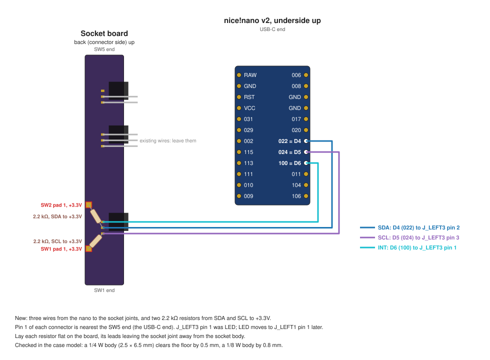
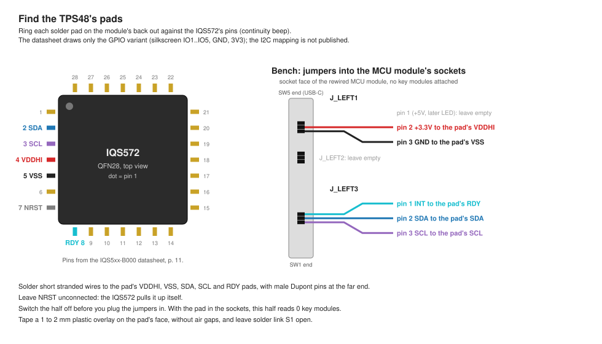

> 💡 Bench bring-up of the [[Pointing module]]'s TPS48 trackpad on the right half: rework the right MCU module, identify the pad's solder pads, and connect the pad to the MCU module's sockets with jumpers. The diagrams come from `electronics/tools/pointing_diagrams.py`.

## 1. Rework the right MCU module

1. Switch the half off, take it off the strap, slide the key modules off, and unscrew the floor.
2. Solder three wires from the nice!nano to the socket joints of J_LEFT3, the connector nearest the SW1 end. Solid-core wire holds its route between the existing wires best; expect about an hour:
   - D6 (silkscreen 100) to J_LEFT3 pin 1, INT. The v3.0 pinout gave this pin to LED, which moves to J_LEFT1 pin 1 once LEDs exist.
   - D4 (022) to J_LEFT3 pin 2, SDA.
   - D5 (024) to J_LEFT3 pin 3, SCL.

   Pin 1 of each connector is the one nearest the SW5 end, which is the USB-C end. Leave the existing wires alone.
3. Solder two 2.2 kΩ resistors on the socket board's back:
   - From the J_LEFT3 pin 2 joint (SDA) to SW2's pad 1, a +3.3V hotswap pad 11.7 mm away.
   - From the J_LEFT3 pin 3 joint (SCL) to SW1's pad 1, 8.9 mm away.

   Lay each body flat on the board, with its leads leaving the joint away from the socket body: the floor's rear stop sits beside the socket body. In the case model, a 1/4 W body clears the floor by 0.5 mm and a 1/8 W body by 0.8 mm. Sleeve bare leads that pass other pads.
4. Check with a meter, half off:
   - Continuity from each nano pin to its socket mouth: probe the mouth with a pin or a needle.
   - About 2.2 kΩ from J_LEFT3 pin 2 and from pin 3 to J_LEFT1 pin 2 (+3.3V).
   - No short between SDA, SCL, INT, +3.3V and GND, pairwise.
5. Dry-fit the floor, then screw it on. Switch on: the half types as before, since the firmware does not depend on the new wires.

## 2. Find the pad's solder pads

The TPS48-P203 has seven solder pads on its back and no connector. They carry the GPIO variant's silkscreen, from the notch end: IO4, IO5, GND, 3V3, IO1, IO2, IO3. The I2C firmware's use of IO1 to IO5 is not published, so those five have to be rung out on the board. GND and 3V3 need only a check against pins 5 and 4.

1. Find pin 1 of the IQS572: a dot or a bevel on the package. The pins count anticlockwise from it, seen from the top, seven per side.
2. With the meter on continuity, touch one probe to a solder pad and a needle on the other probe to each of these pins, and fill in the table:

   | IQS572 pin | Signal | Solder pad |
   | --- | --- | --- |
   | 2 | SDA | one of IO1 to IO5 |
   | 3 | SCL | one of IO1 to IO5 |
   | 4 | VDDHI | 3V3 |
   | 5 | VSS (GND) | GND |
   | 7 | NRST | one of IO1 to IO5, or none |
   | 8 | RDY | one of IO1 to IO5 |

   Pins from the [IQS5xx-B000 datasheet](https://www.azoteq.com/images/stories/pdf/iqs5xx-b000_trackpad_datasheet.pdf), page 11. Pads that match none of them stay unconnected.

## 3. Prepare the pad

1. Solder short stranded wires to the pad's VDDHI, VSS, SDA, SCL and RDY pads, with male Dupont pins at their far ends. Leave NRST unconnected: the IQS572 pulls it up itself.
2. Leave solder link S1 open. Open selects the tuning for a 1 to 2 mm overlay.
3. Tape a 1 to 2 mm plastic overlay to the pad's sensing face with double-sided tape, without air gaps. Azoteq requires an overlay for the pad to work as specified.

## 4. Connect

1. Switch the right half off. Plug the jumpers into the MCU module's socket mouths:

   | Socket | Pad |
   | --- | --- |
   | J_LEFT3 pin 1, INT | RDY |
   | J_LEFT1 pin 2, +3.3V | VDDHI |
   | J_LEFT1 pin 3, GND | VSS |
   | J_LEFT3 pin 2, SDA | SDA |
   | J_LEFT3 pin 3, SCL | SCL |

2. Switch on. The pad occupies the sockets, so the right half reads 0 key modules; type on the left half.
3. Flash the driver build on both halves: the right half runs the pad's driver, and the left half receives its events.
4. Report what the pad does: whether the pointer moves, which way it moves for each finger direction, and whether a tap clicks and two fingers scroll. The axis flips go in the right half's devicetree.
