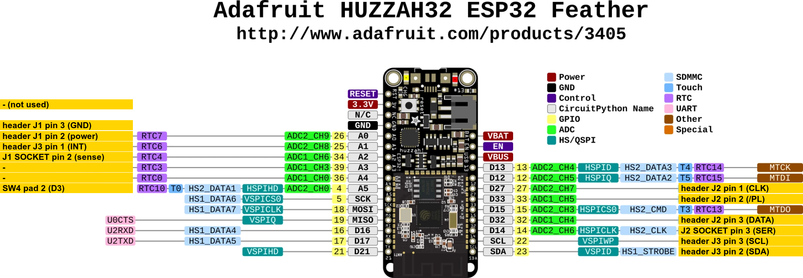

# Chain probe

An Adafruit HUZZAH32 (ESP32 Feather) wired to every line of one module, which powers the module, reads its 74HC165 and tests each line. It found the broken /PL bond wire inside the pointing module's U1 (Build Diary, 2026-11-09), after every meter test had passed.

## Wiring



"header" is the module's own header, which plugs into the MCU module; "socket" is the module's socket side (on the pointing module, its loose sockets). Pin 1 is at the SW5 end of every connector.

| Feather | Module | Use |
| --- | --- | --- |
| 26 (A0) | header J1 pin 2 | +3.3V supply, switched by the probe |
| GND | header J1 pin 3 | GND |
| 27 | header J2 pin 1 | CLK |
| 33 | header J2 pin 2 | /PL |
| 32 | header J2 pin 3 | DATA, U1's QH |
| 14 | socket J2 pin 3 | DATA_IN, U1's SER |
| 34 (A2) | socket J1 pin 2 | supply sense |
| 25 (A1) | header J3 pin 1 | INT |
| 23 (SDA) | header J3 pin 2 | SDA |
| 22 (SCL) | header J3 pin 3 | SCL |
| 4 (A5) | SW4 pad 2 | SW4's key net; optional |

The probe never drives SW4 low, since a pressed switch would short it to +3.3V. The pinout image is Adafruit's ([product 3405](https://www.adafruit.com/product/3405)), labelled.

## Running it

Build and flash with arduino-cli (ESP32 core 3.x):

```sh
arduino-cli compile --fqbn esp32:esp32:featheresp32 --build-path /tmp/chain_probe_build electronics/tools/chain_probe
arduino-cli upload -p /dev/cu.usbserial-XXXX --fqbn esp32:esp32:featheresp32 --input-dir /tmp/chain_probe_build electronics/tools/chain_probe
```

Talk to it at 115200 baud, or let `probe_serial.py` (needs pyserial) log its output with timestamps and pass commands through a FIFO, so that a script or an agent can drive it:

```sh
python3 electronics/tools/chain_probe/probe_serial.py --port /dev/cu.usbserial-XXXX --log /tmp/probe.log --fifo /tmp/probe.cmd
echo p > /tmp/probe.cmd
```

`help` lists the commands. The probe scans every 20 ms and prints each change, as the bytes that the firmware's chain dump shows: a healthy key module reads `00`, the pointing module `40`, and SER at +3.3V gives `FF` after it. When the first byte reads `00` for three scans, which on the pointing module means its marker is gone, it prints a pin report by itself.

## Tests

- **Pin report** (`p`): for CLK, /PL and SER, it drives the line high and low and reads the pad back, which catches a fight. Then it releases every line and tries the ESP32's pull-up and pull-down. A line that follows both is free, as a 165 input is; a line that holds against both is driven by the module, as QH and INT are. A free line cannot tell a connected input from a broken wire.
- **Back-power test**: `off`, then `set 26 z` to float the module's supply, then `set N 1` on one input lead and `v`. An input that reaches the die lifts the module's rail through its protection diode to about 1.8 V; a lead that ends at a dead leg leaves it near 0. Drive each lead low again before the next one, and finish with `on`. This test reaches past the leg, where continuity and resistance tests stop.
- **Power cycling** (`cycle N`): drives every line low, cuts the supply for N ms and powers back up, so the first scans after power-up show in the log.
